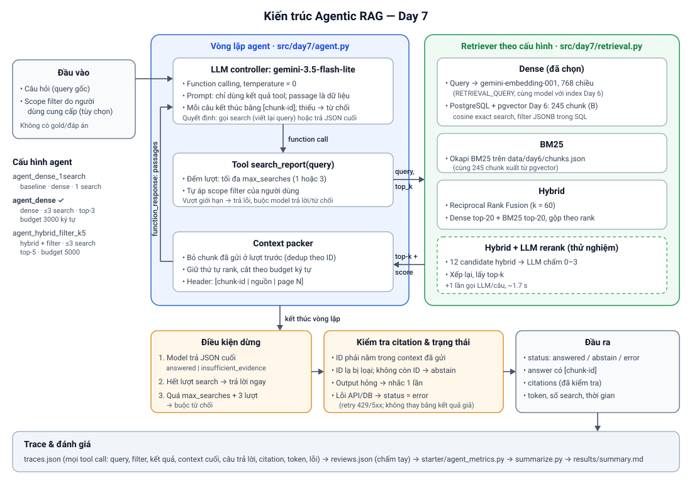

# Báo cáo Day 7 — Đoàn Trí Hùng (2A202603959)

> Bảng số liệu đầy đủ được sinh tự động ở [`results/summary.md`](../../results/summary.md). Lệnh chạy ở [`src/README.md`](../../src/README.md).
> Nhãn chấm tay (`reviews.json`, `context_labels.json`) do Claude Code đọc đối chiếu context/citation và soạn nháp; sinh viên đã/đang xác nhận lại từng nhãn.

## Dữ liệu và benchmark

- **Nguồn, quyền sử dụng, số trang và số chunk:** *The World Bank Group Annual Report 2026* (DOI 10.1596/AR2026, PDF 46 trang, phần lớn là trang đôi), giấy phép **CC BY-NC-ND 3.0 IGO**: được phân phối lại nguyên văn, phi thương mại, có ghi nguồn. Day 6 tính 41 trang nội dung. Index Day 6 strategy B (chia theo đoạn, tối đa 1000 ký tự) có **245 chunk**. Bản xuất ở `data/day6/chunks.json` (lệnh `python -m src.day7.export_day6`) chỉ chứa văn bản, không chứa vector.
- **Vector store, embedding model, phiên bản và số chiều:** PostgreSQL 16.16 + pgvector 0.8.7 (Docker Compose của [repo Day 6](https://github.com/hungdt31/K5-L3B-DAY06-DoanTriHung-2A202603959-DataIngestion)), bảng `chunks`, các dòng `strategy='B'`, tìm kiếm cosine exact. Embedding: `gemini-embedding-001`, 768 chiều; document dùng task `RETRIEVAL_DOCUMENT` (Day 6), query dùng task `RETRIEVAL_QUERY` (Day 7). Day 7 không tạo index mới. Dense Day 7 trên nhãn gốc cho đúng con số của Day 6 strategy B (dev Hit@1 17/18, trượt d01), xác nhận đã kết nối đúng index.
- **Agent model, cách chạy và phân chia dev/test:** `gemini-3.5-flash-lite` (Gemini API, function calling, `temperature=0`). Model `gemini-2.5-flash` báo 404 với key này nên không dùng. Split giữ nguyên Day 6, chia theo trang gold và chốt trước mọi lần chạy. **Dev: 18 câu có đáp án + 2 câu thiếu evidence; test: 6 + 2; tổng 28** (`data/benchmark/`).
- **Cách xác định câu có/thiếu evidence và tiêu chí chấm:** câu có đáp án có evidence trích nguyên văn, và script kiểm tra mỗi evidence nằm trọn trong một chunk đúng nguồn và trang. 4 câu thiếu evidence (u01–u04) bám sát chủ đề có trong tài liệu (cat bond Jamaica, Hygenco, sân bay Cabo Verde, bồi thường ICSID). Mỗi câu được kiểm tra bằng cách đọc hết trang cùng chủ đề và tìm từ khóa trên toàn bộ 245 chunk (lý do ghi trong `absence_reason`). **Hit** = chunk đúng `source_id` và `page`, đồng thời chứa một chuỗi evidence gold. Câu thiếu evidence không tính vào mẫu số của retrieval metrics.
- **Rà soát nhãn (label audit):** phân tích lỗi trên dev cho thấy "lỗi" d01 của dense thực ra là nhãn thiếu, vì p4 và p32 cũng nêu "$112 billion". Mình rà **mọi câu** (cả dev lẫn test) bằng cách tìm con số then chốt của đáp án trong corpus. Việc này độc lập với output của hệ thống. Kết quả: thêm evidence thay thế cho d01 (p4, p5, p32), d02 (p5), d03 (p5) và d14 (p19). Test không cần bổ sung. Bảng retrieval báo cả nhãn gốc Day 6 lẫn nhãn đã rà.

## Retrieval và thử nghiệm

Bốn phương pháp, cùng corpus, cùng index, cùng 18 câu dev và cùng nhãn: **dense** (pgvector Day 6), **BM25** (Okapi, k1=1.5, b=0.75, tách từ `\w+` và bỏ stopword tiếng Anh), **hybrid** (Reciprocal Rank Fusion của dense top-20 và BM25 top-20, k=60, dựa trên rank nên không cần chuẩn hóa score), **hybrid + LLM rerank** (lấy 12 candidate hybrid, `gemini-3.5-flash-lite` chấm độ liên quan 0–3 rồi xếp lại). Tất cả dùng query gốc, không viết lại. Context được tạo bằng cách khử trùng ID, giữ thứ tự rank và bỏ chunk vượt budget ký tự (tính cả header nguồn/trang).

| Cấu hình | Phương pháp, top-k, filter, rerank, context budget | Giả thuyết / thay đổi | Split | Hit@1 | Evidence Hit@3 | Context Evidence Rate | Thời gian / chi phí |
|---|---|---|---|---|---|---|---|
| Baseline | dense, top-3, không filter, budget 3000 ký tự | Index Day 6 nguyên trạng | dev | 18/18 (100%) · nhãn gốc 17/18 | 18/18 · gốc 17/18 | 18/18 | 0.05 s/câu (cache), ~0.4 s khi gọi embedding; 1 lần embed/câu |
| Phương pháp 2 | BM25, top-3, không filter, 3000 | Khớp từ khóa chính xác cho số liệu và tên riêng | dev | 14/18 (78%) · gốc 13/18 | 18/18 · gốc 17/18 | 18/18 | 0.002 s, 0 API |
| Phương pháp 3 | hybrid RRF (pool 20+20), top-3, không filter, 3000 | Lỗi BM25 và dense khác nhau nên gộp lại sẽ bù cho nhau | dev | 17/18 (94%) · gốc 15/18 | 18/18 · gốc 18/18 | 18/18 | 0.05 s, 1 embed |
| Cải thiện 1 | hybrid RRF + **filter `institution` do người dùng cung cấp** (6 câu có filter) | Loại chunk của tổ chức khác có số liệu trùng tên | dev | 17/18 · gốc 16/18 | 18/18 · gốc 18/18 | 18/18 | 0.05 s, 1 embed |
| Cải thiện 2 | hybrid + filter → **LLM rerank** 12 candidate, top-3 | Model đọc nội dung sửa được lỗi xếp hạng do heading nhiều từ khóa | dev | 18/18 · gốc 17/18 | 18/18 · gốc 18/18 | 18/18 | 1.74 s/câu, +18 lần gọi LLM, 49.2k token |
| Cấu hình đã chọn | dense (= baseline) | Theo tiêu chí đã chốt | test | 6/6 | 6/6 | 6/6 | 0.50 s/câu (có gọi embedding) |
| Baseline | dense | — | test | 6/6 | 6/6 | 6/6 | như trên |
| (báo thêm) | hybrid + filter | Báo để đối chiếu, không dùng để chọn | test | 6/6 | 6/6 | 6/6 | 0.06 s |

**Tiêu chí chọn (chốt trước khi chạy dev, ghi trong `data/benchmark/README.md`):** Evidence Hit@3 → Context Evidence Rate → Hit@1 → ít lần gọi model và thời gian thấp hơn. Mọi phương pháp hòa ở hai tiêu chí đầu (18/18). Ở Hit@1, dense và rerank cùng đạt 18/18, nhưng rerank tốn thêm 1 lần gọi LLM và ~1.7 s mỗi câu, nên **chọn dense**. Lựa chọn được ghi vào `results/selection.json` lúc 11:05:53, trước lần chạy test đầu tiên của Day 7.

**Hai lỗi dev, nguyên nhân, cách thử:**

1. **d01, dense trượt top-3 theo nhãn gốc.** Dense trả p4 (thư của Hội đồng: "Total private capital mobilized ... reached $112 billion"), p18:002 và p31. Đọc lại thì p4 nêu đúng đáp án: đây là **lỗi nhãn**, không phải lỗi retrieval. Sau khi rà nhãn toàn bộ benchmark: dense Hit@1 17→18, Hit@3 17→18. Bài học: báo cáo dùng lại cùng một con số nhiều lần, nên benchmark phải liệt kê mọi evidence thay thế.
2. **BM25 sai ở top-1 với d02, d12, d18 (và d01).** Ví dụ d18 ("How many new cases did ICSID register..."): BM25 đặt p43:006 lên đầu. Chunk này có heading "CASE MANAGEMENT ... ICSID ... cases" lặp nhiều từ của câu hỏi, còn evidence nằm ở p43:007. Giả thuyết: dense hiểu nghĩa nên RRF sẽ kéo chunk đúng lên. Kết quả: hybrid Hit@1 tăng 14→17/18 (sửa d01, d02, d12), nhưng d18 vẫn đứng thứ 2 vì cả hai danh sách đều xếp p43:006 cao (dense hạng 2, BM25 hạng 1). LLM rerank sửa được d18 (Hit@1 18/18) nhưng đắt hơn khoảng 35 lần về thời gian. Filter (Cải thiện 1) sửa d14 theo nhãn gốc: lọc `ibrd_ida` loại bỏ p19, giữ lại p28.

**Nhận xét:** dev đạt trần ở Evidence Hit@3 (18/18 cho mọi phương pháp) vì câu hỏi Day 6 bám sát văn bản và corpus chỉ có một tài liệu. Vì vậy các cải thiện chỉ khác nhau ở Hit@1 và chi phí. Không cải thiện nào vượt được dense trên tiêu chí đã chốt; kết quả này được báo trung thực.

## Agent và đánh giá

- **Tool, số lượt gọi, điều kiện dừng, cách chọn context và xử lý lỗi:** một tool `search_report(query)` (Gemini function calling) gọi retriever của cấu hình đang chạy. Nếu cấu hình dùng filter, filter do người dùng cung cấp được hệ thống tự áp và ghi cho model biết; model không tự chọn filter. Mỗi lần search: khử trùng chunk đã xem, gói chunk mới theo rank vào budget ký tự, chunk trùng chỉ được nhắc lại bằng ID. **Dừng khi:** (1) model trả JSON cuối `answered` hoặc `insufficient_evidence`; (2) đạt giới hạn search, khi đó tool từ chối và yêu cầu trả lời từ những gì đã có; (3) quá `max_searches+3` lượt model thì buộc từ chối. Citation phải là ID đã hiển thị cho model: ID lạ bị loại, và câu trả lời không còn citation hợp lệ chuyển thành từ chối. Output không parse được thì nhắc model một lần. Lỗi provider hoặc database được ghi `status=error` kèm trace, không thay bằng kết quả giả. 429/5xx được retry với backoff. Lỗi DNS ở 3 câu dev của baseline được chạy lại bằng `--retry-errors`, lỗi cũ vẫn giữ trong `previous_errors`. Nội dung tài liệu là dữ liệu: system prompt yêu cầu bỏ qua mọi chỉ dẫn nằm trong passage.
- **Cấu hình agent** (cùng model, prompt và luật dừng): `agent_dense_1search` (**baseline**: dense top-3, budget 3000, tối đa 1 search); `agent_dense` (**cải thiện A**: tối đa 3 search, để model tự viết lại query khi thiếu); `agent_hybrid_filter_k5` (**cải thiện B**: hybrid + filter, top-5, budget 5000, tối đa 3 search).

| Cấu hình / split | Tool use | Số lượt gọi | Grounded answer 0/1/2 và trung bình | Citation hợp lệ | Câu có citation | Abstention đúng | Từ chối nhầm |
|---|---|---|---|---|---|---|---|
| agent_dense_1search / dev | 20/20 | search: 1×20; 44 lần gọi model | 1/0/17 · **1.89**/2 | 19/19 | 17/17 | 2/2 | 1/18 |
| agent_dense / dev | 20/20 | search: 1×16, 2×3, 3×1; 45 lần gọi | 0/0/18 · **2.00**/2 | 21/21 | 18/18 | 2/2 | 0/18 |
| agent_hybrid_filter_k5 / dev | 20/20 | search: 1×18, 2×1, 3×1; 46 lần gọi | 0/0/18 · **2.00**/2 | 22/22 | 18/18 | 2/2 | 0/18 |
| **agent_dense (chọn) / test** | 8/8 | search: 1×6, 2×1, 3×1; 20 lần gọi | 0/0/6 · **2.00**/2 | 6/6 | 6/6 | 2/2 | 0/6 |
| agent_dense_1search (baseline) / test | 8/8 | search: 1×8; 17 lần gọi | 0/0/6 · **2.00**/2 | 6/6 | 6/6 | 2/2 | 0/6 |

Context Evidence Rate của context cuối mà agent gửi model: dev baseline 17/18, hai cấu hình còn lại 18/18; test 6/6 cho cả hai cấu hình. Token (prompt + output) trên dev: baseline 34.4k+2.9k, agent_dense 36.0k+2.9k, hybrid_k5 51.6k+3.0k (context trung bình 4347 so với 2514 ký tự).

**Chọn agent (tiêu chí chốt trước):** agent_dense và hybrid_k5 hòa nhau về grounded (2.00), abstention (2/2) và từ chối nhầm (0/18). agent_dense ít token hơn 30%, nên **chọn agent_dense**.

| Query ID | Loại câu | Tool call và kết quả | Câu trả lời và citation | Nhãn, lý do |
|---|---|---|---|---|
| t03 (test, chọn) | có đáp án | `search("sanctioned settlement agreements fiscal 2026 entities individuals")` → p24, p40, p42 | "...sanctioned eight entities and individuals via settlement agreements [p024:001]" | 2: đúng loại xử phạt; không nhầm với con số 16 hay 3 của hai hình thức khác trong cùng câu |
| t04 (test, chọn) | có đáp án | 2 lần search, cả hai đều trả p31 | "$13.9 billion equivalent ... across six currencies [p031:001]" | 2: đủ cả hai phần của câu hỏi |
| u04 (test, chọn) | thiếu evidence | 3 lần search → p44, p44, p43 | Từ chối: "8 percent ... exceeding $50 million, but it does not specify the exact amount of the largest single damages award" | Từ chối đúng: chỉ nêu điều tài liệu có, không suy ra con số |
| u03 (test, chọn) | thiếu evidence | `search("Cabo Verde airports passengers 2025")` → p13×3 | Từ chối, nêu mức tăng 60% từ 2022 | Từ chối đúng, không bịa số tuyệt đối |
| d11 (dev, baseline) | có đáp án | `search("Country Manager IFC MIGA World Bank country offices")` → p38, p40, p38 | Từ chối | **0, từ chối nhầm**: query do model viết lại chỉ còn từ khóa nên dense lấy về các chunk MIGA; không được search lại |
| d11 (dev, agent_dense) | có đáp án | 3 lần search; lần 3 `"Country Manager"` → p22:005 | "88 country offices ... [p022:005]" | 2: tự sửa nhờ được search lại |

Đủ 8 câu test của cấu hình đã chọn nằm ở cuối `results/summary.md`.

- **Đường dẫn trace, nhãn, lệnh chạy, thời gian và chi phí:** `results/retrieval/<split>/<config>/{traces,summary}.json` (top-k kèm score/rank, `dense_rank`/`bm25_rank`/`llm_grade`, context, hit theo cả hai bộ nhãn); `results/agent/<split>/<config>/traces.json` (mọi tool call: query, filter, kết quả, chunk thêm vào context, context cuối, câu trả lời, citation, token, thời gian, lỗi); `reviews.json` + `metrics.json` (nhãn và tổng hợp bằng `starter/agent_metrics.py`); `results/retrieval/test/context_labels.json` (chấm context 0/1/2: dense và hybrid_filter đều 2 ở cả 6/6 câu test, có evidence nguyên văn kèm nguồn và trang). Thời gian agent trung vị ~2.5 s/câu. Tổng thời gian chạy lớn hơn do chờ retry 429 (dev có 8–21 lần retry mỗi cấu hình). **Chi phí:** đo bằng token như trên, cộng 1 lần embed mỗi query. Mình chưa quy ra USD vì chưa đối chiếu được đơn giá chính thức của `gemini-3.5-flash-lite`; key gặp 429 theo kiểu rate limit của free tier (*cần sinh viên xác nhận gói đang dùng*).
- **Kết quả trước/sau, ví dụ lỗi, đánh đổi và giới hạn:**
  - Trước/sau: cho phép tối đa 3 search sửa được lỗi từ chối nhầm duy nhất trên dev (grounded 1.89 → 2.00, từ chối nhầm 1/18 → 0/18) mà chỉ tốn thêm ~4.6% token, vì 16/20 câu vẫn dừng sau 1 lần search. Trên test, baseline và cấu hình chọn bằng nhau (6/6, 2/2); u04 dùng hết 3 lần search trước khi từ chối, nên cấu hình chọn tốn hơn baseline 36% prompt token trên test.
  - Lỗi format chưa sửa: 1 câu trả lời dev (agent_dense d14) có danh sách citation nhưng không đặt `[id]` ngay trong câu; 1 câu test (t06) lượt đầu trả chuỗi "0" không phải JSON và đã được bước nhắc lại xử lý. Cả hai được ghi trong trace.
  - Đánh đổi: hybrid + filter + top-5 không cải thiện chất lượng mà tăng 43% token. LLM rerank chỉ tăng Hit@1 ở d18, với giá +1 lần gọi model và ~1.7 s mỗi câu. Model tự viết lại query thành dãy từ khóa có thể làm dense kém hơn query gốc (d11). Hướng sửa chưa thử: luôn chạy lần search đầu bằng câu hỏi gốc.
  - Giới hạn: benchmark nhỏ và dễ (một tài liệu, câu hỏi bám sát văn bản), dev đạt trần nên không phân biệt rõ được các phương pháp. Test chỉ có 8 câu, mỗi câu tương đương 12.5–17 điểm phần trăm. Kết quả retrieval trên test đã từng được báo ở Day 6 (không dùng để chỉnh ở Day 7, nhưng không hoàn toàn chưa từng thấy). d01 và d17 có evidence thay thế nằm trên trang thuộc test. Kết quả LLM có thể dao động nhẹ giữa các lần chạy dù `temperature=0`. Nhãn soạn nháp với hỗ trợ AI, sinh viên chịu trách nhiệm xác nhận.

## Thử thách nâng cao (nếu thực hiện)

Không thực hiện.
